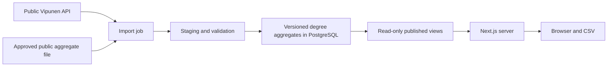

# Architecture, operations and ownership

## Proposed deployment

Use Next.js with TypeScript for the dashboard, PostgreSQL for validated statistics, and a scheduled or manually invoked import command outside the web application. Use Supabase as the first hosted PostgreSQL provider and Vercel for the frontend when hosting is approved. Keep the first import and its tests runnable locally. A single repository, one web application and one database are sufficient for the public pilot.

Use explicit SQL for aggregation and parameterized, bounded reads on the server. Dashboard requests read the published release in PostgreSQL. For Vercel functions use a small connection pool against Supabase's transaction pooler, with driver settings compatible with that mode. Run migrations on a direct or session connection. Keep the database URL server-only. Include release ID, language and filters in public cache keys. An atomic release change selects a new key. Restricted results, if introduced later, require independent cache and authorization rules. [Supabase connections](https://supabase.com/docs/guides/database/connecting-to-postgres) · [Next.js deployment](https://nextjs.org/docs/app/getting-started/deploying)

Use ordinary accessible HTML tables for the first small comparison. Add AG Grid Community for longer sortable/filterable tables and AG Charts Community for standalone line or bar charts if they improve the tested task. Supply the same cells in a keyboard-readable table. The Community grid supports API-driven CSV export. Native Excel export and enterprise grid grouping/pivot features would create a paid dependency. Precompute field summaries in SQL. Generate CSV from the approved result set so suppression and spreadsheet-safe text handling apply to every client. [Grid CSV](https://www.ag-grid.com/javascript-data-grid/csv-export/) · [Grid Excel](https://www.ag-grid.com/javascript-data-grid/excel-export/) · [Chart editions](https://www.ag-grid.com/charts/react/community-vs-enterprise/)

## Data model

Implement only the tables needed for final degrees in milestone 1. Keep source-specific typed facts and share a small number of reference and provenance tables as other topics arrive.

| Proposed relation | Grain, keys and responsibility |
| --- | --- |
| `dataset` | Stable source/resource identifier, publisher, endpoint, licence evidence and scope, disclosure policy, expected schema and refresh rule. |
| `import_run` / `release` | A run is one attempt for a dataset and filter slice. Record timestamps, source-as-of, request and schema hashes, transformation revision, counts, checks, release state and prior release. Store error type without response payloads. A successful release can be referenced by several retry attempts. |
| `institution` and source identifiers | Stable internal ID plus source, code as text, valid dates and multilingual labels. Handle mergers through dated relationships. Retain historical attribution. Keep Arcada's source code `02535` in configuration or reference data. |
| `education_code` / `field` | Scheme, version, source code, labels and dated parent relationship. Preserve the observed classification on the release. A local programme mapping later needs institution, programme ID, source entity, validity, mapping evidence and approver. Ambiguous or many-to-many mappings stay unavailable for comparison. |
| `degree_awards` | First published grain: release, statistical year, institution, national education code, education level and field under a specified classification. Aggregate only over verified mutually exclusive source dimensions. Unique constraint on that grain. Per-cell count plus disclosure state. Institution and level totals are views or separately approved official cells. |
| `indicator_definition` | Versioned unit, population, time basis, calculation and aggregation rules, precision, allowed comparison levels, caveats and source. Later rates store numerator and denominator, means store permitted components or the publisher's published aggregate. |
| Published views | Return an approved value or a disclosure/missing state, unit, period, coverage, definition and release ID. SQL consumers, exports and charts share these views. A release pointer per complete dataset slice identifies the current version. |

Keep dataset-specific detail in private staging for validation. Preserve source bytes temporarily only where terms permit. Content hash and retrieval metadata identify each artifact. Where retention is permitted, store compressed releases in private EU storage with a documented expiry. If storage is prohibited retain the allowed derived facts and manifest, and mark the limit on historical replay. Avoid one universal table of arbitrary measures and dimensions. Do not join unrelated counts through display labels.

For later survey cells, include instrument version, question ID, eligible population, respondents to the survey, valid answers to the question, response scale, cohort, collection date and disclosure rule. Use a state such as observed, rounded, suppressed, missing or inapplicable. Preserve literal zero. A classification break, denominator change or a noncomparable partial year interrupts the trend.

## Repeatable import and release

1. Choose the dataset, final/provisional status, institution and year slice. Read metadata and count before fetching. Derive a deterministic partition, preferably small enough to retrieve in one response. Preflight the schema, source terms and requested columns. A manual file follows the same adapter contract and carries a report name, filter manifest and checksum.
2. Acquire a lock per dataset and slice. Land input in a run-specific staging area. For paged resources require a demonstrably stable total ordering or use smaller nonoverlapping filters. Source counts and update stamps can reveal some mid-fetch changes. Where a coherent cut cannot be established, abandon the attempt and retain the previous release. Use bounded retries/backoff and respect publisher throttling.
3. Preserve leading zeros, check codes, supported release types, period completeness, duplicate source grains and numeric constraints. Reject unfamiliar dimensions that could change aggregation. Quarantine ambiguous mappings. Keep a source row signature for auditing. Identical-looking rows require a grain investigation before deduplication. Test rounding, suppression, small-cell complements and unavailable denominators.
4. Reconcile degree totals against the publisher checks and validate component sums where the measures are additive and exact. Keep discrepancies by institution, period and definition. Inspect changes in row count, missingness and source revisions before making a release current.
5. Within one transaction install the complete replacement slice and update its current-release pointer. A repeat of the same slice, input digest and transformation revision is a no-op. A correction gets a new revision, including source deletions. An interrupted run cannot expose half a vintage. Readers that span multiple slices pin and return the same set of release IDs throughout a query or export.
6. Record completion, size, duration, reconciliation results and last successful refresh. A failing scheduled job reports the affected slice and leaves its data-as-of date visible. Start with a manual public run. Add a weekly GitHub Actions trigger after measuring source cadence and job cost. Limit workflow permissions. Credentials for publishing are unavailable to pull-request jobs.

Run deterministic SQL and import tests against local PostgreSQL with public-safe or synthetic fixtures. Exercise one deliberately changed release, one failure after staging, duplicate submissions and concurrent attempts. Network-dependent source checks run separately so a publisher outage cannot break every pull request. Agents can reproduce a failed case with one command and the logged manifest. Keep migrations, query contracts and examples in Git.

## Database setup and portability

The research scripts run now. Milestone 1 will deliver the first actual SQL migration and CI job with the reviewed schema. Pin the Supabase CLI and database major in the repository at that point. The local CLI here reported 2.112.0. Docker is installed but its Linux daemon was unavailable. No database migration or app was executed during discovery.

From a fresh checkout after milestone 1, the intended local workflow is to start Docker, run `supabase start` with the tracked configuration, apply the migrations with `supabase db reset --local` **only on a disposable local database**, import the public test slice and run the degree checks. Record exact import/test commands with their implementation. For the first migration, use `supabase migration new degree_awards`, edit the generated SQL, replay it on an empty database, then verify upgrade from the previous release on later changes. Run the same SQL with ordinary PostgreSQL in CI. Check CLI help when pinning because v3 changed defaults and generated config names. [Local development](https://supabase.com/docs/guides/local-development) · [CLI changes](https://supabase.com/changelog/supabase-cli-v3)

Application readers get SELECT on approved views only. Use an unexposed schema for staging and published SQL relations when only the server connects. Revoke broad default grants and independently test the read, import and migration roles. If a Supabase HTTP Data API is exposed later, explicitly grant only the intended objects, use row-level security on exposed tables and test invoker permissions for views. Keep service-role or migration credentials out of the frontend and application read path. [Supabase API security](https://supabase.com/docs/guides/api/securing-your-api)

## Costs and alternatives

Estimates in USD per month, checked 26 November 2026, before tax and usage overages. Assume one deploying user, a small public aggregate dataset, weekly imports, one region and no paid add-ons. Procurement and actual organization subscriptions can change the incremental cost.

| Scenario | Indicative cost | Reason to choose it |
| --- | ---: | --- |
| Local discovery and milestone 1 | $0 incremental hosting | Python, local PostgreSQL and the public repository suffice. Use existing hardware. |
| Small private-repository Vercel pilot | From $20 if Supabase Free is available, otherwise budget about $45 with a new Supabase Pro organization | Vercel Pro includes one deploying seat. Vercel Hobby's Git integration excludes private organization repositories. Supabase Free lists 500 MB database space and pauses idle projects. |
| Managed production baseline | About $45 with one new Vercel Pro team and one Supabase Pro organization/project | $20 frontend + $25 backend. Additional deploying seats are $20 each. Additional Supabase projects on a paid organization start around $10 each. Budget separately for extra compute, traffic, long retention, restore requirements and institutional support. |
| Cloudflare Workers with Supabase Pro | From about $30 | Workers Paid starts at $5. Next.js uses the OpenNext adapter. Test the worker runtime, database connection, caching and previews. The savings may justify a trial if hosting cost dominates. |
| Neon with Vercel | About $35 using Neon's example $15 intermittent workload and one Vercel Pro seat | Standard PostgreSQL and scale-to-zero are attractive for irregular use. Usage billing varies with active compute and storage. Evaluate if the project chiefly needs a database. |
| Institution-hosted Node and PostgreSQL | Existing capacity may give $0 incremental service fees | Assign operators for patching, TLS, backups, restore exercises, monitoring and incident coverage. Standard SQL and the Node deployment path make this a realistic exit. |

[Vercel prices](https://vercel.com/docs/plans/pro-plan) · [Private Git integration](https://vercel.com/docs/git) · [Supabase prices](https://supabase.com/pricing) · [Supabase organization billing and free limits](https://supabase.com/docs/guides/platform/billing-on-supabase) · [Cloudflare pricing](https://developers.cloudflare.com/workers/platform/pricing/) · [OpenNext deployment](https://developers.cloudflare.com/workers/framework-guides/web-apps/nextjs/) · [Neon pricing](https://neon.com/pricing) · [Self-hosting responsibilities](https://supabase.com/docs/guides/self-hosting)

Size a pilot from the actual aggregate tables, indexes, two retained releases, staging peak and backups. The staff resource alone exceeds 1.8 million records. Loading the whole catalogue into a free database is an unjustified assumption. Measure storage, p95 query time and connection count on representative slices before buying capacity. Prefer a release-specific SQL summary and a targeted index before introducing a separate warehouse. A static published extract could serve a single annual chart, but typed SQL simplifies correction history, field comparisons and multiple sources. Revisit a static export for read-only distribution when its dimensions are known.

## Institutional boundary and publication

Use only public aggregates or synthetic inputs in this repository, tests, agent prompts and previews. A future Arvo importer belongs on institution-managed EU infrastructure with an approved static outbound IP, its own credentials, restricted store, logs and backups. An authorized steward can release a defined aggregate file after disclosure review. Use an allowlist of columns, suppress small and complementary cells, reject free text and preserve the distinction between local and national figures. Keep the restricted store and credentials outside the public application project.

Before institutional processing, the institution owns purpose, lawful basis, recipients, retention, processor agreements, access review and any required impact assessment. Confirm location and access for database, backups, logs, support, analytics, build artifacts and CDN independently. An EU database region alone cannot settle these questions. Identity via Entra and role-based access can follow an approved restricted use case. [EU General Data Protection Regulation](https://eur-lex.europa.eu/eli/reg/2016/679) · [Arvo onboarding](https://wiki.eduuni.fi/pages/viewpage.action?pageId=806980264)

The repository is public under Aamu AI. A software release still requires a rights holder, a licence decision and permission for any institutional branding. MIT offers a short permissive grant. Apache 2.0 adds an explicit patent grant and notice obligations. Prefer Apache 2.0 for review if several institutions will contribute. The owner makes the final choice. Software licensing does not grant rights to republish datasets or screenshots. [MIT text](https://opensource.org/license/mit) · [Apache 2.0 text](https://opensource.org/license/apache-2-0)

The owner reports that the Supabase project is connected to GitHub. Verify its deployment settings and costs before applying hosted migrations. The first milestone runs locally.
